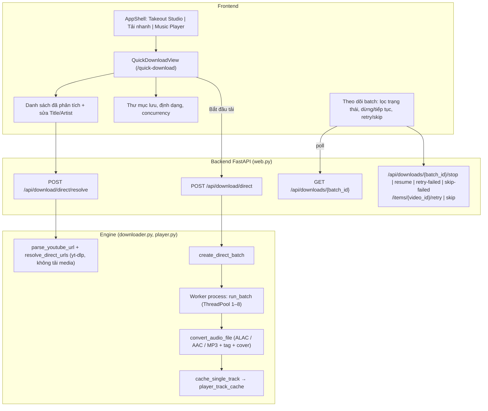

# Design: Tải nhanh (Quick Download)

Cập nhật: **2026-10-26**, đối chiếu với code trên branch `feature-studio-direct-download`.

> Thiết kế ban đầu đặt tính năng này thành "Step 05 Direct" trong Takeout Studio (`Header.tsx`, `DirectDownloadView.tsx`). Phương án đó đã bị thay bằng một **mode độc lập** `quick_download`. Tài liệu dưới đây mô tả phương án đang chạy.

## 1. Tổng quan kiến trúc



## 2. Điều hướng frontend

- `AppMode = 'takeout' | 'quick_download' | 'player'` trong [AppShell.tsx](../../../frontend/src/components/AppShell.tsx). Stepper 01–04 chỉ hiện ở mode `takeout`.
- [App.tsx](../../../frontend/src/App.tsx) nhận `/quick-download` và `/quick`, lưu route cuối vào `localStorage` (`auralytica_last_route`).
- Tải nhanh không phụ thuộc import Takeout. Màn hình rỗng của Studio có nút mở thẳng Tải nhanh.

## 3. API

### 3.1 `POST /api/download/direct/resolve`

Request `{"urls": ["..."]}`. Mỗi dòng có thể là:

| Dạng | Ví dụ |
| --- | --- |
| Watch (www / m / music) | `https://www.youtube.com/watch?v=ID&si=...` |
| Link rút gọn | `https://youtu.be/ID` |
| Shorts, embed | `/shorts/ID`, `/embed/ID` |
| Playlist thuần | `https://www.youtube.com/playlist?list=PL...` |
| ID trần | chuỗi 11 ký tự |

Link watch có cả `v=` và `list=` được hiểu là **một video**, không mở rộng playlist. Tham số tracking bị bỏ do chỉ lấy ID.

Response:

```json
{
  "videos": [
    {
      "video_id": "ID",
      "url": "https://www.youtube.com/watch?v=ID",
      "title": "Tên bài đã làm sạch",
      "artist": "Nghệ sĩ gợi ý",
      "album": "Auralytica",
      "channel": "Tên kênh gốc",
      "duration": 240,
      "thumbnail_url": "https://..."
    }
  ],
  "invalid_urls": ["dòng không nhận dạng được"],
  "unavailable": [
    { "video_id": "ID2", "url": "dòng gốc", "code": "unavailable", "message": "Video không khả dụng..." }
  ],
  "truncated": false
}
```

- Video lẻ được lấy metadata song song (tối đa 8 luồng, `socket_timeout=10`) bằng `yt_dlp.extract_info(download=False)`. Video yt-dlp từ chối (private, đã xoá, giới hạn tuổi/vùng, lỗi mạng) vào `unavailable`, mã lỗi lấy từ `_ytdlp.summarize_error`, và **không** được đưa vào danh sách tải.
- Playlist dùng `extract_flat='in_playlist'`. Playlist lỗi được đưa vào `invalid_urls`. Mục `[Private video]` / `[Deleted video]` / `[Unavailable video]` trong playlist vào `unavailable`.
- Tối đa `MAX_DIRECT_VIDEOS = 1000` video mỗi lần; vượt quá thì cắt bớt và đặt `truncated=true`.
- Request giới hạn 500 dòng, mỗi dòng 2.048 ký tự.
- Title và artist gợi ý được tách bằng `clean_title` + `parse_artist_title` của `converter.py`. Hậu tố "- Topic" trong tên kênh bị bỏ.
- Trùng ID giữa các dòng chỉ giữ một bản.

### 3.2 `POST /api/download/direct`

Request (`DirectDownloadSubmitRequest`):

```json
{
  "videos": [{ "video_id": "ID", "title": "...", "artist": "...", "thumbnail_url": "..." }],
  "output_dir": "~/Music/Auralytica",
  "format": "m4a_alac",
  "concurrency": 3
}
```

Response: `{"batch_id": 12, "status": "queued", "total_items": 1}`.

| Mã | Khi nào |
| --- | --- |
| 409 | Đang có batch khác `queued`/`running` (Takeout hoặc Tải nhanh); hệ thống chỉ có một worker |
| 422 | `video_id` không đúng 11 ký tự, `videos` rỗng hoặc quá 1.000, `format` lạ, `concurrency` ngoài 1–8 |

`format` nhận `m4a_alac`/`alac`, `m4a_aac`/`aac`, `mp3`/`mp3_320`, `raw` và được chuẩn hoá về `m4a_alac`, `m4a_aac`, `mp3`, `raw`.

### 3.3 Trạng thái và điều khiển

Dùng lại API batch của Takeout, không có endpoint riêng:

- `GET /api/downloads/{batch_id}?page=&page_size=&status=`
- `POST /api/downloads/{batch_id}/stop`, `/resume`
- `POST /api/downloads/{batch_id}/retry-failed`, `/skip-failed`
- `POST /api/downloads/{batch_id}/items/{video_id}/retry`, `/skip`

## 4. Dữ liệu

Schema **v7** ([storage.py](../../../src/auralytica/storage.py)):

- `download_batches.kind` (`takeout` | `direct`, mặc định `takeout`).
- Bảng `direct_download_items(batch_id, video_id, title, artist)`, khoá ngoại tới `download_items`. Bảng này giữ title/artist người dùng sửa cho từng item.
- Migration chuyển các batch có `settings.batch_is_direct:{id}='1'` (cách đánh dấu ở v6) sang `kind='direct'`, chép title/artist từ `videos` vào `direct_download_items`, rồi xoá các key `batch_is_direct:*`.

`create_direct_batch` ghi trong một transaction:

1. Từ chối (`BatchBusyError`, HTTP 409) nếu đang có batch `queued`/`running`.
2. `download_batches`: dòng mới với `kind='direct'` và `output_dir` đã `expanduser().resolve()`.
3. `settings`: `batch_format`, `batch_concurrency` (1–8), `batch_clean_names=1`, `batch_embed_metadata=1` theo batch.
4. `videos`: chỉ thêm dòng mới nếu ID chưa có (`ON CONFLICT DO NOTHING`), không đặt `user_group`. **Dòng của video Takeout không bị sửa.**
5. `download_items` + `direct_download_items` cho mỗi video (trùng ID trong request chỉ giữ một).

Sau transaction, `app.state.launch_worker` khởi động worker nền như batch Takeout.

### Khoá

| Trạng thái | Takeout review (Import/Explore/Dedup/metadata) | Tạo batch mới |
| --- | --- | --- |
| Batch Takeout `queued`/`running` | Khoá (`batch_locked=true`) | 409 cho Tải nhanh; Takeout trả lại batch đang chạy |
| Batch Tải nhanh `queued`/`running` | **Không khoá** | 409 cho cả hai loại |

`GET /api/workflow` trả thêm `download_busy` (có batch bất kỳ đang chiếm worker). `storage.review_locked` là nơi duy nhất định nghĩa khoá review.

## 5. Worker

- `run_batch` đọc `kind`. Title/artist của item lấy từ `direct_download_items` (fallback `videos`). Với batch tải nhanh, **title/artist người dùng sửa được ưu tiên** hơn metadata yt-dlp khi ghi tag và đặt tên file. Batch Takeout làm ngược lại.
- Bỏ qua (skip) item lỗi trong batch Tải nhanh chỉ đổi trạng thái item; với batch Takeout còn ghi `download_selections.keep=0` để loại video khỏi các lượt Takeout sau.
- Định dạng `m4a_alac`, `m4a_aac`, `mp3` được chuyển mã qua `convert_audio_file`, nhúng tag và ảnh bìa. Album mặc định là `Auralytica`.
- Tên file: `Artist - Title.ext`, bỏ ký tự cấm, tối đa 120 ký tự, thêm hậu tố "(n)" nếu trùng tên.
- Sau khi publish thành công, `cache_single_track` đưa file vào `player_track_cache` nên bài hiện ngay trong Music Player. Lỗi indexing bị nuốt, không làm hỏng item.

## 6. Frontend: `QuickDownloadView`

- Textarea nhiều dòng, nút dán từ clipboard, nút phân tích.
- Danh sách đã phân tích: thumbnail, thời lượng, ô sửa Title/Artist, nút `Wand2` làm sạch tag YouTube, xem trước tên file, xoá dòng, mở link YouTube.
- Khối báo cáo `#direct-resolve-report` liệt kê video không tải được (kèm lý do), dòng không nhận dạng được và thông báo cắt bớt.
- Nút bắt đầu bị khoá khi `download_busy` (prop từ `App`), hiện "Đang có lượt tải chạy".
- Tuỳ chọn: thư mục lưu (mặc định `~/Music/Auralytica`), ALAC / MP3 320 / AAC 256, concurrency 1–8. Các giá trị này dùng chung key `localStorage` với `DownloadView` (`auralytica-output`, `auralytica-format`, `auralytica-concurrency`).
- Batch đang theo dõi được nhớ qua `auralytica_direct_batch_id`. Bảng item có lọc theo trạng thái, phân trang 20 dòng, nút chuyển sang Player.

## 7. Giới hạn đã biết

- Chỉ một batch chạy tại một thời điểm (giới hạn sẵn có của worker). Không có hàng đợi: lượt mới bị từ chối cho tới khi lượt đang chạy xong hoặc được tạm dừng.
- Lỗi mạng tạm thời lúc resolve cũng đưa video vào `unavailable`; người dùng cần phân tích lại.
- Batch Tải nhanh hiện chung danh sách lịch sử với batch Takeout ở trang Download, có nhãn "Tải nhanh" trong ô chọn lượt.
